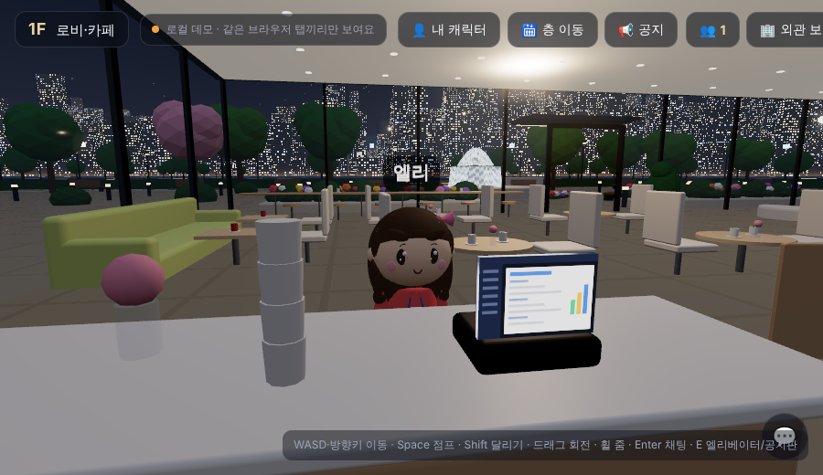
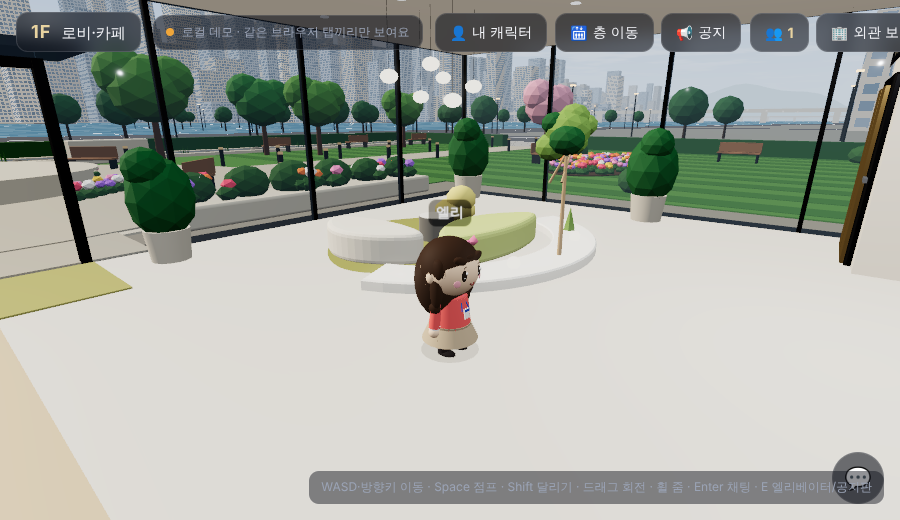
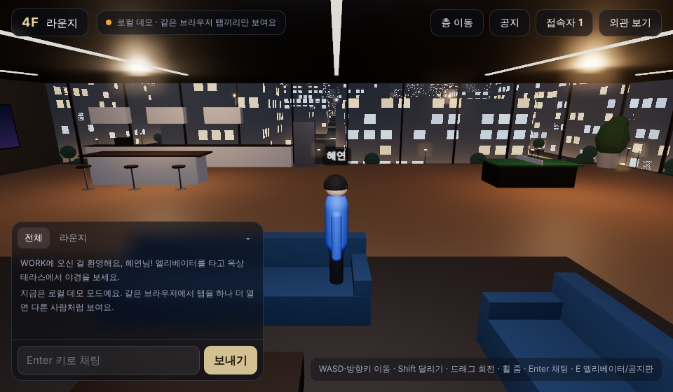

# 우리 회사 메타버스 사옥 만들기

코딩을 몰라도 **복사 → 글자 몇 개 바꾸기 → 켜기**로 우리 회사만의 메타버스 사옥을 만들 수 있는 소스입니다.
강가의 작은 4층 유리 사옥(20명 안팎)과 앞마당 정원을 귀여운 캐릭터로 걸어다니며, 같이 접속한 동료와 채팅하고 공지를 나눌 수 있어요.


| 공간 | 들어 있는 것 |
|---|---|
| 정원 | 분수 광장, 개울(징검다리 · 물소리), 꽃밭, 벤치, 정원등 |
| 1F 로비·카페 | 안내 비서(말 걸기), 사내 카페, 라운지 |
| 2F 업무 공간 | 책상 16자리, 💻 일하기("일하는 중…" 풍선) |
| 3F 회의실 | 유리 회의실 2개, 공지판 |
| 4F 라운지·오락존 | 소파 라운지, 탕비실, 탁구대, 🥊 샌드백 치기 게임, ⚔️ 결투장 |
| 옥상 | 야경 테라스 |

⚔️ **소환의 검 결투**: 4층 결투장 옆 **결투 관리인**에게 정식 신청 → 접속자 중 상대 고르기(하루 2번까지) → 상대가 수락하면 모든 층에 "대결이 시작되었습니다" → 연타 대결. 모두 Lv.1에서 시작, 이기면 Lv +1, 지면 😵패배자 칭호(다음에 이기면 떨어짐). 👾 업무 괴물과는 몇 번이든 연습할 수 있어요(레벨 영향 없음).

그 밖에: 남자/여자 캐릭터와 옷 색 고르기 · 낮/밤 바꾸기 · 앉기 · 점프 · 바닥 눌러 이동 · 엘리베이터 · 휴대폰 조이스틱

---

## 따라 하기 (약 20분)

준비물: GitHub 계정, Supabase 계정 (둘 다 무료)

### 1단계 — 소스 복사하기 (Fork)
1. 이 저장소 페이지 오른쪽 위의 **Fork** 버튼을 누릅니다.
2. Repository name에 원하는 이름(예: `office`)을 넣고 **Create fork**를 누릅니다.
3. 이제 내 계정에 똑같은 저장소가 생겼어요. 아래 단계는 모두 **내 저장소**에서 합니다.

### 2단계 — 회사 이름 바꾸기
1. 내 저장소에서 `src` 폴더 → `config.js` 파일을 엽니다.
2. 오른쪽 위 **연필(✏️) 버튼**을 누릅니다.
3. 아래 두 줄의 따옴표 안 글자를 바꿉니다.
   ```js
   companyName: 'WORK',                         // ← 회사 이름 (로고 벽 · 간판 · 표지석에 나와요)
   companyTagline: '강이 내려다보이는 우리 회사 사옥', // ← 시작 화면 소개 문구
   ```
4. `defaultNotices` 아래의 기본 공지 문장도 원하면 바꿉니다.
5. 아래쪽 **Commit changes** 버튼을 누릅니다.

### 3단계 — 같이 접속하기 (Supabase 연결)
이 단계를 건너뛰면 "로컬 데모 모드"로 열려서, 같은 브라우저의 탭끼리만 서로 보여요.

1. https://supabase.com 에 가입하고 **New project**로 프로젝트를 만듭니다. (지역은 Seoul 추천)
2. 왼쪽 메뉴 **Project Settings → Data API**에서 **Project URL**을 복사합니다.
3. **Project Settings → API Keys**에서 **Publishable key**(`sb_publishable_`로 시작)를 복사합니다.
   - ⚠️ **Secret key**(`sb_secret_`)는 절대 쓰지 마세요. 소스는 누구나 볼 수 있어요.
4. 다시 `src/config.js`를 연필 버튼으로 열고, 아래 세 줄을 **내 것으로** 바꾼 뒤 Commit 합니다.
   ```js
   siteHost: 'roronee91-star.github.io',  // ← 내 GitHub 아이디.github.io (예: 'myid.github.io')
   supabaseUrl: 'https://….supabase.co',  // ← 2번에서 복사한 주소
   supabaseAnonKey: 'sb_publishable_…',   // ← 3번에서 복사한 키
   ```
   - `siteHost`가 내 주소가 아니면 Supabase에 연결하지 않아요. 원래 주인의 키가 남아 있어도 남의 사무실에 섞여 들어가지 않게 하는 안전장치예요.
5. 공지판을 쓰려면 Supabase 왼쪽 메뉴 **SQL Editor → New query**에 [`docs/supabase.sql`](docs/supabase.sql) 내용을 붙여 넣고 **Run**을 누릅니다.

### 4단계 — 사이트 켜기 (GitHub Pages)
1. 내 저장소의 **Settings → Pages**로 갑니다.
2. **Source**: `Deploy from a branch`, **Branch**: `main`, 폴더 `/ (root)`를 고르고 **Save**.
3. 1~2분 뒤 `https://내아이디.github.io/저장소이름/` 주소로 열려요. 이 주소를 직원들에게 공유하면 끝!

---

## 조작 방법

| | 컴퓨터 | 휴대폰 |
|---|---|---|
| 이동 | WASD · 방향키 (Shift 달리기) | 왼쪽 아래 조이스틱 |
| 바닥 눌러 이동 | 바닥 클릭 | 바닥 톡 |
| 시점 | 드래그 · 휠 | 드래그 · 두 손가락 |
| 점프 | Space | 점프 버튼 |
| 앉기 · 일하기 · 말 걸기 | E | 화면 아래 버튼 |
| 채팅 | Enter | 💬 버튼 |
| 층 이동 | 엘리베이터 앞에 가면 자동으로 물어봐요 (위쪽 🛗 버튼도 가능) | |

## 알아 두면 좋은 점
- **링크를 아는 사람은 누구나 들어올 수 있어요.** 회사 비밀이나 개인정보는 채팅 · 공지에 쓰지 마세요.
- Supabase 무료 플랜은 한 달 메시지 수에 한도가 있어요. 20명 정도는 충분하지만, 사용량은 Supabase **Usage** 메뉴에서 확인하세요.
- 공지는 누구나 올릴 수 있게 열려 있어요. 지우기는 Supabase 대시보드의 Table Editor → `notices`에서 합니다.
- 서버 프로그램이나 빌드 과정이 없어요. 파일만 올리면 바로 동작합니다.

## 파일 지도 (고쳐 보고 싶은 분을 위해)
| 파일 | 내용 |
|---|---|
| `src/config.js` | 회사 이름 · Supabase 연결 · 기본 공지 |
| `src/building.js` | 사옥 건물과 층별 가구 · 색 |
| `src/garden.js` | 정원 · 분수 · 개울 |
| `src/world.js` | 하늘(낮 · 밤) · 도시 · 강 · 다리 |
| `src/avatar.js` | 캐릭터 모양 · 동작 |
| `src/main.js` | 걷기 · 카메라 · 채팅 · 층 이동 · 게임 |
| `src/net.js` | 실시간 같이 접속 |

내 컴퓨터에서 미리 보려면: 폴더에서 `python3 -m http.server 8000` 실행 후 http://localhost:8000

## 라이선스
[MIT](LICENSE) — 누구나 자유롭게 쓰고 고치고 나눌 수 있어요. 출처 표시(이 저장소 또는 LICENSE 파일)만 남겨 주세요.
three.js와 supabase-js도 MIT 라이선스입니다.

| | |
|---|---|
|  |  |
|  |  |
